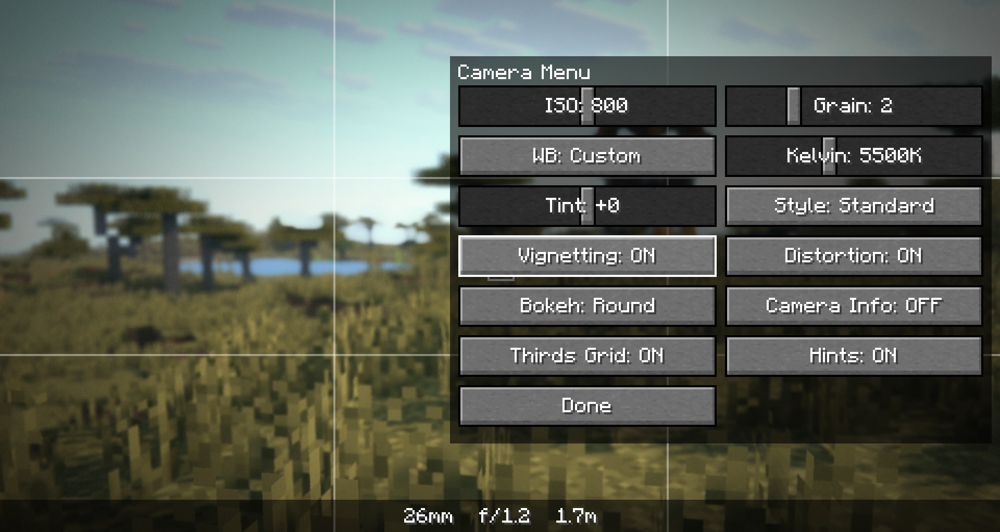
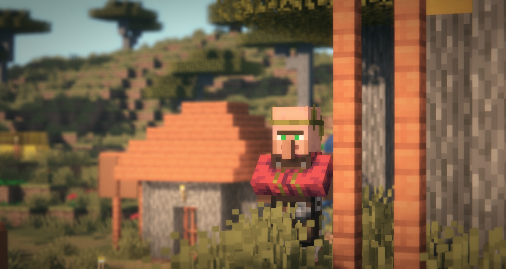
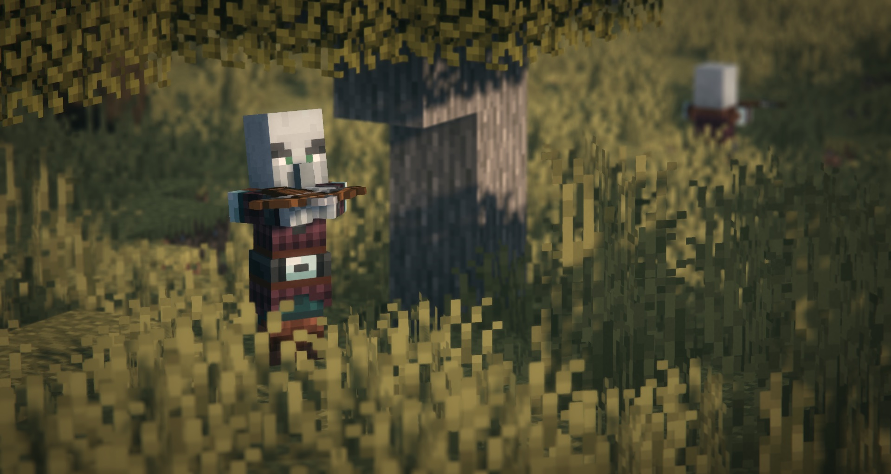
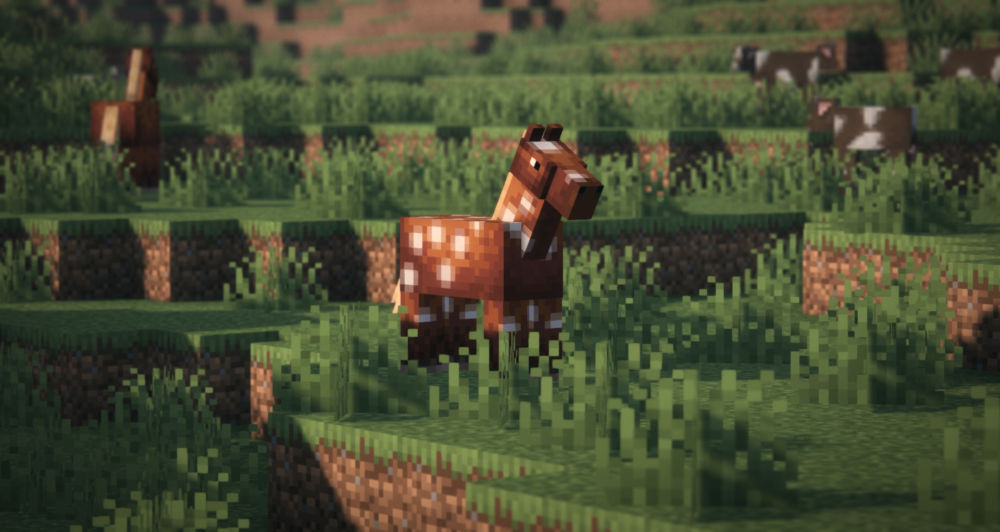
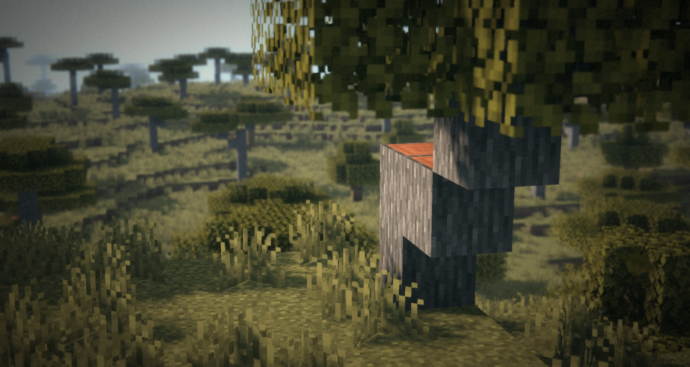
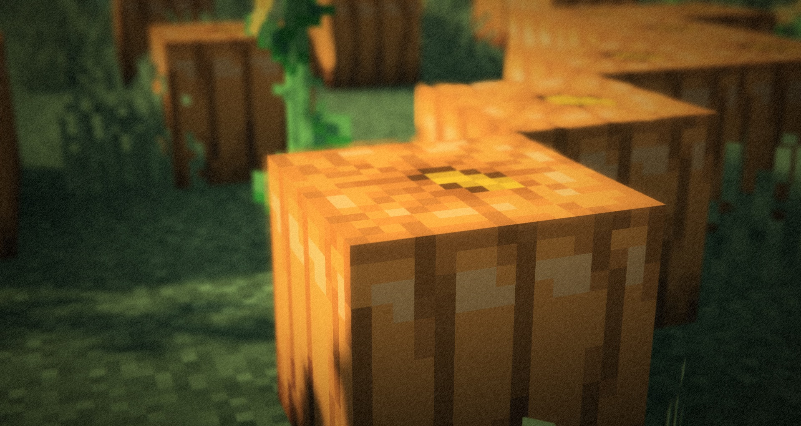
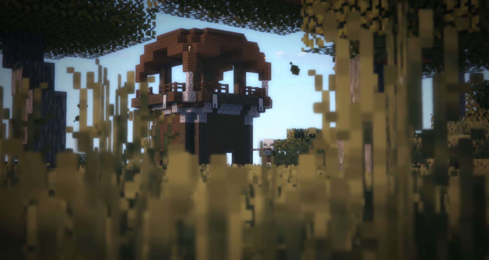

# Framecraft

A camera for Minecraft (Fabric, 26.3). Press `V` to look through a full-frame camera with a zoom lens, real depth of field, autofocus and a shutter. Works with or without an Iris shader pack.

- **Focal length** 14–200 mm on a full-frame sensor; sets the field of view.
- **Aperture** f/1.2–f/22 in third stops.
- **Depth of field** from the thin-lens circle of confusion, so the blur matches a real lens at 1 block = 1 m. The game test checks rendered blur against the formula.
- **Bokeh shape**: round or hexagonal out-of-focus highlights, with bright lights opening into clear shapes.
- **Back-button autofocus**: hold right mouse to focus on whatever is under the focus box. Release and focus stays put.
- **Movable focus point**: hold Ctrl and move the mouse.
- **Exposure and colour**: ISO for brightness, film grain, white balance, tint and picture styles, plus lens vignetting and distortion.
- **Shutter** saves a clean `framecraft_*.png` to `screenshots/`, without the viewfinder.



The camera menu (`X`), open over the viewfinder. Every setting is covered under [Camera menu](#camera-menu-x).

## Gallery

Straight out of the camera, no edits.

| | |
|---|---|
|  |  |
|  |  |
|  |  |

## Installing

Requires Minecraft 26.3, [Fabric Loader](https://fabricmc.net/use/) 0.20 or newer, [Fabric API](https://modrinth.com/mod/fabric-api) and Java 25. Download `framecraft-<version>.jar` from the [releases page](https://github.com/sajibsrs/framecraft/releases) and put it and Fabric API in your `mods` folder. Framecraft is client-only, so it works on any server.

## Controls

| Input | Action |
|---|---|
| `V` | Enter / leave camera mode |
| Scroll | Zoom |
| Ctrl + Scroll | Aperture (scroll up opens up to a smaller f-number) |
| Right mouse (hold) | Autofocus |
| Ctrl + Mouse move | Move the focus point |
| Left mouse | Take a photo |
| `X` | Camera menu |
| `F1` | Hide the viewfinder for a clean live view |

The keys apply only in camera mode; elsewhere `X`, the mouse and scroll keep their normal use. While in camera mode you can't break blocks or use items, and the HUD and your hand are hidden. `V` and `X` can be rebound under Options → Controls → Key Binds → Framecraft.

Each time you enter camera mode the lens is at 50 mm, f/2.8, focused at 5 m, with the focus point in the centre.

## Viewfinder

- **Focus box**: white while idle, **green** once the subject under it is sharp, **red** if the lens can't focus there (open sky, or closer than the lens's minimum focus distance, about 0.3 m at 14 mm and 1.2 m at 200 mm).
- **Bottom strip**: focal length, aperture and focus distance.
- **Rule-of-thirds grid** and **control hints** along the top; both can be turned off in the menu.
- The screen flashes white when the shutter fires.

## Camera menu (`X`)

The menu opens on the right and leaves the world unblurred, so every change shows live. Settings are saved when it closes.

| Setting | Range | Default |
|---|---|---|
| ISO | 100–6400 in third stops. ISO 800 shows the scene as the game draws it; each stop down darkens by 1 EV, each stop up brightens by 1 EV | 800 |
| Grain | Off, 1–8; film-style noise, strongest in the shadows. Independent of ISO | Off |
| WB (white balance) | Daylight 5500 K, Cloudy 6500 K, Shade 7500 K, Tungsten 3200 K, Fluorescent 4000 K, Custom | Custom |
| Kelvin | 2500–10000 K, used with Custom | 5500 K |
| Tint | −10 (green) to +10 (magenta) | 0 |
| Style | Standard, Neutral, Vivid, Monochrome | Standard |
| Vignetting | Darker corners, strongest wide open | On |
| Distortion | Barrel at wide angles, pincushion when zoomed in | Off |
| Bokeh | Shape of out-of-focus lights: Round, Hexagon (corner pointing up) | Round |
| Camera Info | Lens, focus, depth of field and exposure readout | Off |
| Thirds Grid | Rule-of-thirds lines | On |
| Hints | Control hints | On |

White balance works like a camera's: the light in Minecraft counts as daylight, so 5500 K leaves colours as the game (or your shader pack) draws them. A lower Kelvin setting cools the picture, a higher one warms it.

## Taking photos

- Photos go to `.minecraft/screenshots/` as `framecraft_<date>_<time>.png`, at your window's resolution.
- The viewfinder marks are never in the photo. With **Camera Info** on, the photo carries the info panel in the bottom-left corner.
- **For strong background blur**: zoom in, open the aperture (f/1.2–f/2.8) and get close to the subject. Depth of field gets shallower the closer you focus, so 85 mm at f/1.2 on a mob a few blocks away melts the background, while the same lens on a mob 30 blocks away keeps much of the scene sharp.
- **For bokeh**: put small bright lights (torches, lanterns, glowstone, sunlit glints) far behind a close subject and open up to f/1.2–f/2. Each light turns into the Bokeh shape from the menu. Shapes show best on lights much smaller than their blur, and at night, when the lights are the brightest thing in frame. Only out-of-focus lights turn into shapes; a subject in focus and the sky (for example through leaves) blur normally.
- **For everything sharp**: zoom out and stop down to f/8–f/16.
- Minecraft's large texture pixels hide small amounts of blur. A subject a little out of focus can still look sharp, so check the focus box colour rather than the image.

## Shader packs

Works with Iris shader packs: depth of field and colour are applied on top of the pack's image. Shader packs that have their own depth of field will add to Framecraft's blur, so turn theirs off.

## Settings file

Everything in the camera menu is stored in `config/framecraft.properties`. Delete the file to go back to the defaults.

## Building

```
./gradlew build                          # jar in build/libs
./gradlew runClientGameTest              # test world; screenshots in build/run/clientGameTest/screenshots
./gradlew runClientGameTest -PwithIris   # same, with Iris + Sodium from the local Prism instance and a shader pack
```

`-PshaderPack=<dir>` picks the pack for `-PwithIris`. Run the game with `-Dframecraft.debugDepth=true` to see the depth buffer the blur is built from.

## License

[MIT](LICENSE)
